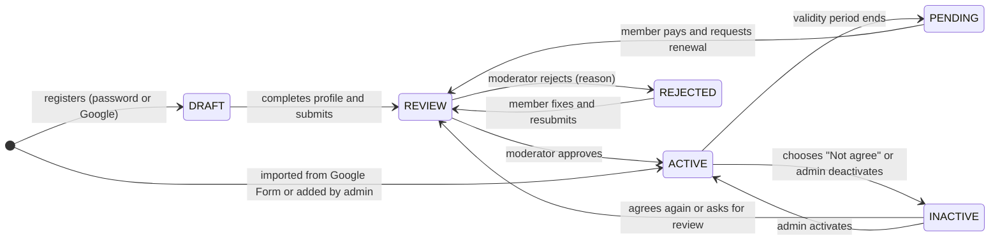
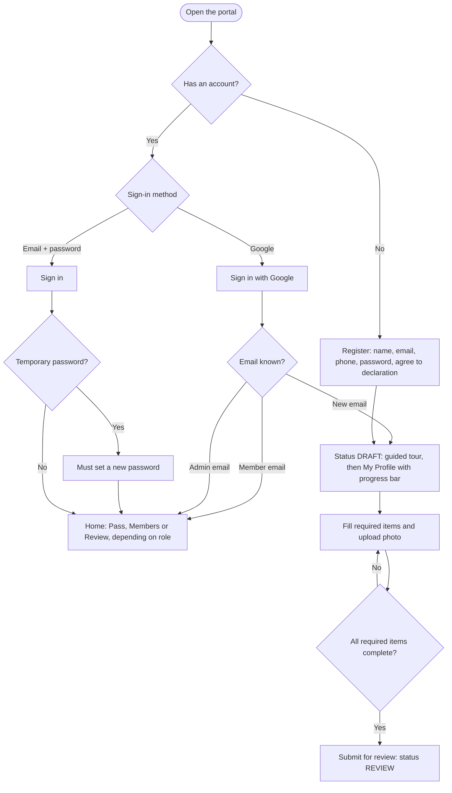
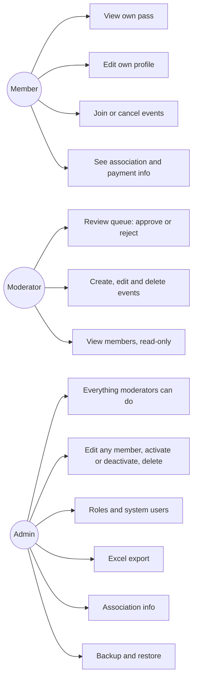
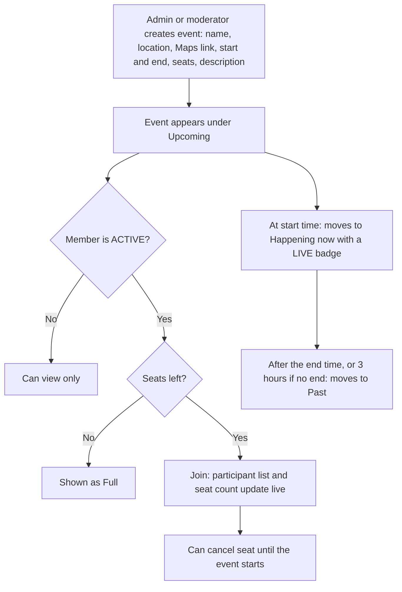
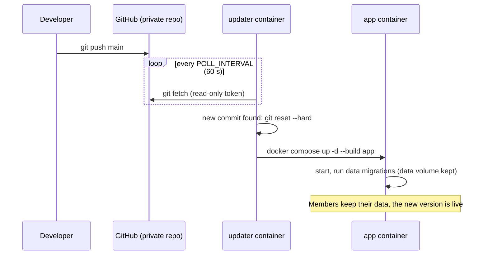

# AISARC Membership Portal · ប្រព័ន្ធគ្រប់គ្រងសមាជិក

**Version 1.6.0** · Mobile-first membership management for **ស.គ.ឯ.ស.ប.ក – AISARC**
(សមាគម គិលានុបដ្ឋាកឯកទេសដាក់ថ្នាំសណ្តំ និង ប្រពោធនកម្មកម្ពុជា).

<p>
  
  
  
  
</p>

> Screenshots use made-up demo data only.

## Contents

1. [Features](#features)
2. [Screenshots](#screenshots)
3. [How it works (flowcharts)](#how-it-works)
4. [User manual – members](#user-manual--members)
5. [User manual – moderators](#user-manual--moderators)
6. [User manual – admins](#user-manual--admins)
7. [Membership status](#membership-status)
8. [Installation & deployment](#installation--deployment)
9. [Configuration (.env)](#configuration-env)
10. [Accounts](#accounts)
11. [Security](#security)
12. [Data, backup & restore](#data-backup--restore)
13. [Troubleshooting](#troubleshooting)
14. [Version history](#version-history)

---

## Features

### For members · សមាជិក
| Feature | Description |
| --- | --- |
| Sign in | Email + password, or **Sign in with Google** (same email as the member record). |
| Self-registration | New people register, then complete their profile and **submit it for review**. |
| Profile completion | Live progress bar, required items marked **\***, missing items highlighted; submitting is blocked until complete. |
| Digital membership pass | Blue card with logo, Khmer + English name, birthday, membership no., member since and photo. |
| Anti-screenshot pass | Active passes have a moving shine and a live clock, so a screenshot is easy to spot. |
| Status messages | The pass explains the current status and the next step (submit, fix & resubmit, renew…). |
| Edit own information | All personal, contact, work and registration fields; photo and certificate upload. |
| Locked fields | "Member since", membership no., status, validity and login email can only be changed by admins. |
| Declaration consent | Agree / Not agree; "Not agree" makes the membership INACTIVE. |
| Events | See events grouped by **Happening now / Upcoming / Past**, open the location in **Google Maps**, join or cancel a seat, and see who joined (live). |
| Association info | Association details, membership fee, bank account (copy button), payment QR and contacts. |
| Renewal | When the membership expires (PENDING), members pay and tap **Request renewal**. |
| Password | Change password (key icon); admins can issue a temporary password. |
| System tour | Bilingual guided tour on first sign-in; the **?** button replays it any time. |

### For moderators · អ្នកសម្របសម្រួល
| Feature | Description |
| --- | --- |
| Review queue | Members waiting for review, with status filters and search. |
| Approve | Approving assigns the membership no., "member since" and validity. |
| Reject with reason | "Information missing", "Information incorrect" or "Other" + message; the member sees it and resubmits. |
| Events | Create, edit and delete events; see participants with phone numbers and membership numbers. |

### For admins · អ្នកគ្រប់គ្រង
| Feature | Description |
| --- | --- |
| Member management | Search, filter by status, add, edit every field, activate / deactivate. |
| Delete safely | Delete is hidden in a "Danger zone" and requires typing the membership no. |
| Roles | Make any member a moderator or admin; create stand-alone admin / moderator accounts. |
| Passwords | Generate temporary passwords (valid 72 h, must be changed at first sign-in). |
| Excel export | Export **all** members or only **selected** members to `.xlsx`. |
| Association info | Edit the association details, fee, validity period, bank account, payment QR and contacts. |
| Backup & restore | Download one file with the whole database and uploaded files; restore it later. |
| Events | Everything moderators can do. |

### Platform
- Mobile-first, responsive (phone → desktop), installable as a home-screen app (PWA manifest).
- Khmer + English throughout; Kantumruy Pro font.
- Fast and light: no front-end build step or framework (~115 KB of front-end code, uncompressed), Node.js 24 with built-in SQLite.
- Docker Compose deployment with **auto-update on `git push`**.
- Version number shown on the login screen and at the bottom of every page.

---

## Screenshots

| Sign in | Register | Complete profile |
| :---: | :---: | :---: |
|  |  |  |
| **System tour** | **Membership pass** | **Rejected – fix & resubmit** |
|  |  |  |
| **My profile** | **Events** | **Event + Google Maps** |
|  |  |  |
| **Association & payment** | **Admin – members** | **Moderator – review queue** |
|  |  |  |
| **Reject with reason** | **Select & export to Excel** | **Admin – users & backup** |
|  |  |  |
| **New event** | | |
|  | | |

**Desktop – admin member page**


---

## How it works

### Membership lifecycle



### Sign-up and sign-in



### Who can do what



### Events



### Deployment and auto-update



---

## User manual – members

### 1. First time: register · ចុះឈ្មោះ
1. Open the portal and tap **Register · ចុះឈ្មោះ**.
2. Enter your name in Khmer and Latin letters, your email, phone and a password (8+ characters).
3. Read and tick the declaration, then tap **Register**.
4. A short **system tour** starts. Tap **Next · បន្ទាប់** to go through it, or **Skip · រំលង**.

> Already in the association's Google Form list? Don't register. Tap **Sign in with Google** with the same email
> you used in the form, or ask the admin for a temporary password.

### 2. Complete your profile and submit · បំពេញ និង ដាក់ស្នើ
1. On **My Profile**, the progress card shows how many required items (**\***) are done. Tap a red item to jump to it.
2. Fill in every required item and upload a **4x6 photo** (**Upload** next to the photo).
3. Tap **រក្សាទុក · Save** at any time to continue later.
4. When the bar says **Ready to submit**, tap **ដាក់ស្នើ · Submit** and confirm. Your status becomes **REVIEW**.
5. If a moderator rejects your application, the reason is shown on your pass. Fix it, then tap
   **Fix & resubmit · កែ និង ដាក់ស្នើម្ដងទៀត**.

### 3. Your pass · កាតសមាជិក
- The **Pass** tab shows your membership card. Show it at events and activities.
- When **ACTIVE**, a light sweeps across the card and the date and time are live. This proves it's not a screenshot.
- Under the card you see your phone number and **Valid until** date, plus a message if you need to do something.

### 4. Edit your information · កែប្រែព័ត៌មាន
- Open the **Profile** tab, change what you need and tap **Save**.
- Fields with 🔒 (member since, membership no., status, validity, login email) are managed by the admin.
- Choosing **Not agree · មិនយល់ព្រម** on the declaration makes your membership **INACTIVE**.

### 5. Events · ព្រឹត្តិការណ៍
1. Open **Events**. Events are grouped into **Happening now**, **Upcoming** and **Past** (tap to expand).
2. Tap an event to see the time, location, seats left and who joined.
3. Tap **Google Maps** to get directions.
4. Tap **Join this event · ចូលរួម** (ACTIVE members only). To give your seat back, tap **Cancel my seat** before the event starts.

### 6. Pay and renew · បង់ប្រាក់ និង បន្តសមាជិកភាព
1. Open **Association** to see the membership fee, bank account (tap **Copy account no.**) and payment QR.
2. After paying, send the receipt as described in the payment instructions.
3. When your membership has expired (**PENDING**), tap **Request renewal** on your pass. A moderator will review it.

### 7. Password and help · ពាក្យសម្ងាត់ និង ជំនួយ
- **Key icon** (top right): change your password.
- **? button**: replay the system tour.
- **Sign-out icon**: signs you out on every device.
- Forgot your password? Sign in with Google, or ask the admin for a temporary password (valid 72 hours).

---

## User manual – moderators

1. Sign in. The **Review** tab opens with the **Review** filter selected. These members are waiting for you.
2. Tap a member. Check their information, photo and certificate.
3. Tap **✓ Approve** to make them ACTIVE. They get a membership no. and their validity starts.
4. Or tap **✕ Reject**, choose a reason (*information missing*, *incorrect*, or *other* + message) and confirm.
   The member sees your message and can resubmit.
5. **Events tab → + New event**: enter name, location, an optional exact Google Maps link (Google Maps → Share →
   Copy link), start and end, number of seats (0 = unlimited) and description, then **Publish event**.
   Use **Test map link** to check the location.
6. Open an event to see participants (with phone and membership no.), **Edit event** or **Delete event**.

---

## User manual – admins

### Members · សមាជិក
| Task | How |
| --- | --- |
| Find a member | **Members** tab → search by name, phone, email, membership no. or workplace; use the status filters. |
| Add a member | **+ Add** → fill in the form → **Create member**. |
| Edit a member | Tap the member → change any field (including member since, membership no., status, valid until) → **Save changes**. |
| Approve / reject | Same as moderators (buttons on the member page). |
| Activate / deactivate | **Activate** or **Deactivate** on the member page. |
| Make moderator / admin | Member page → **Account → Role**. |
| Reset password | Member page → **Reset password** → share the temporary password privately (valid 72 h). |
| Delete | Member page → bottom **Danger zone** → type the membership no. → **Delete permanently**. |
| Export to Excel | **Export all**, or **Select** → tap members (or **Select all**) → **Export selected**. |

### Admin tab · គ្រប់គ្រងប្រព័ន្ធ
| Task | How |
| --- | --- |
| Add a system user | **Add system user** → username, role (moderator / admin), temporary password → **Create user**. |
| Change role / remove | In **System users**, change the role, or tap **✕** (member accounts are only demoted to member). |
| Reset a staff password | Key icon next to the user. |
| Backup | **⬇ Download backup**. Keep the file safe; it contains all personal data. |
| Restore | Open **Restore from a backup file** → choose the file → **Restore** → everyone is signed out. |
| Association info | **Edit association info**: name, about, fee, validity (months), bank, account, QR, contacts. |

> You can't delete or demote yourself or the last admin.

---

## Membership status

| Status | Label colour | Meaning | Who acts |
| --- | --- | --- | --- |
| DRAFT | grey | New applicant still completing the profile (not submitted) | Member |
| REVIEW | orange | Waiting for approval | Moderator / admin |
| ACTIVE | green | Active member, no action needed. The pass shines and shows a live clock | – |
| PENDING | grey | Membership expired (validity from Association Info); renewal needed | Member pays and requests renewal |
| REJECTED | red | Rejected because information is missing or wrong; reason shown | Member fixes and resubmits |
| INACTIVE | red | Member chose "Not agree" on the declaration, or an admin deactivated them | Member / admin |

The pass card is always blue; only the status label changes colour.

---

## Installation & deployment

Tech: Node.js 24 + Express 5, built-in `node:sqlite`, vanilla JS (no build step), Docker (`node:24-alpine`).

### Local development

```bash
npm install
ADMIN_USERNAME=admin ADMIN_PASSWORD='<a-long-random-password>' COOKIE_SECURE=false npm run dev   # http://localhost:3000
npm run import -- "path/to/responses.xlsx"        # optional: load the Google Form spreadsheet
```

### Server (Docker Compose, auto-update on git push)

```bash
git clone <your-repo-url> aisarc && cd aisarc
cp .env.example .env            # edit ADMIN_PASSWORD, SESSION_SECRET, PUBLIC_URL, GOOGLE_CLIENT_ID ...
docker compose up -d --build
# optional, once: import the Google Form spreadsheet
docker compose cp members.xlsx app:/tmp/members.xlsx
docker compose exec app node scripts/import.js /tmp/members.xlsx
```

The `updater` service checks the git remote every `POLL_INTERVAL` seconds (default 60). When you `git push` to
`GIT_BRANCH` (default `main`), it pulls, rebuilds and restarts the `app` container. Member data lives in the
`aisarc-data` Docker volume and survives updates. Logs: `docker compose logs -f updater`.

- **Private repo over HTTPS:** set `GIT_USERNAME` and `GIT_TOKEN` (read-only: GitHub fine-grained token with
  *Contents: Read-only*, or a GitLab deploy token) and optionally `GIT_REPO_URL`. The token is passed to git through
  a credential helper and is never stored in the repo config or logs.
- **Private repo over SSH:** put a read-only deploy key (`id_ed25519`, mode 600) and `known_hosts` in a folder and set `SSH_KEY_DIR`.
- After changing `docker-compose.yml` or the updater itself, run `docker compose up -d --build` once by hand.

### HTTPS and Google Sign-In

1. Point your domain at the server and set `DOMAIN` and `PUBLIC_URL=https://members.example.org` in `.env`.
2. `docker compose --profile https up -d` (Caddy gets a Let's Encrypt certificate automatically), or use your own proxy or Cloudflare.
3. Google Cloud Console → APIs & Services → Credentials → **OAuth client ID (Web application)**:
   - *Authorized JavaScript origins*: `https://members.example.org`
   - *Authorized redirect URIs*: `https://members.example.org/auth/google/callback`
4. Set `GOOGLE_CLIENT_ID`. The redirect URI defaults to `${PUBLIC_URL}/auth/google/callback`. Redirect sign-in also
   works in Telegram and Facebook in-app browsers.
5. Members sign in with the Google account matching their member email. Unknown Google accounts become new
   applicants (DRAFT). Google accounts in `ADMIN_EMAILS` are admins.

---

## Configuration (.env)

| Variable | Purpose |
| --- | --- |
| `APP_PORT`, `APP_BIND` | Published port (default 8080) and interface (`127.0.0.1` when a proxy runs on the same host). |
| `PUBLIC_URL` | Public https address. Enables Secure cookies + HSTS and the Google redirect URI. |
| `ADMIN_USERNAME`, `ADMIN_PASSWORD` | First admin, only created when no admin exists; must change password at first sign-in. |
| `SESSION_SECRET` | Long random string for signing sessions (auto-generated in the data volume if empty). |
| `COOKIE_SECURE` | Leave empty (auto). `false` only for local http testing. |
| `TRUST_PROXY` | Proxies allowed to set `X-Forwarded-For` (default: loopback and private networks). |
| `GOOGLE_CLIENT_ID`, `GOOGLE_REDIRECT_URI`, `ADMIN_EMAILS` | Google Sign-In settings. |
| `GIT_BRANCH`, `POLL_INTERVAL`, `GIT_REPO_URL`, `GIT_USERNAME`, `GIT_TOKEN`, `SSH_KEY_DIR` | Auto-update settings. |
| `DOMAIN` | Domain for the optional Caddy HTTPS proxy. |

See [.env.example](.env.example) for examples.

---

## Accounts

| Who | Username | Initial password |
| --- | --- | --- |
| First admin | `ADMIN_USERNAME` | `ADMIN_PASSWORD` from `.env`; must be changed at first sign-in |
| Imported member | their email | none: sign in with Google, or ask an admin for a temporary password |
| Self-registered member | their email | chosen at registration |
| Admin / moderator created in the Admin tab | chosen by the admin | temporary password (72 h) |

---

## Security

- **Passwords:** scrypt (N=2^15, per-password salt), constant-time checks that don't block the server; older hashes
  are upgraded at the next sign-in. Temporary passwords expire after 72 hours, and "must change" is enforced by the server.
- **Sessions:** signed HttpOnly, SameSite=Lax cookie, `Secure` automatically on https, 14 days. Logout, password change,
  reset and role change revoke all of that user's sessions; a restore signs everyone out.
- **Rate limits:** 10 failed sign-ins per account and 30 per IP per 15 minutes; 5 registrations per IP.
- **Email ownership:** only admins change login emails. Google sign-in proves ownership and removes passwords set by
  someone who hadn't proven it.
- **Uploads:** JPEG/PNG/WebP (+ PDF certificates) checked against the real file content, max 8 MB, random names,
  owner/staff-only access, sandboxed when served.
- **Web protections:** strict Content-Security-Policy, HSTS, X-Frame-Options, `nosniff`, no-store API caching,
  parameterized SQL, HTML-escaped output, no error details sent to clients.
- **Docker:** non-root user, read-only filesystem, all capabilities dropped. The updater only gets the git settings.
- **Auto-update risk:** anyone who can push to the watched branch controls what runs on the server. Keep the repo
  private, protect the branch, and use a read-only token.

---

## Data, backup & restore

- Member fields follow the original Google Form columns (`public/fields.js`). The fields required before submitting
  are listed in `SUBMIT_REQUIRED` in the same file.
- **Backup:** Admin tab → *Download backup* → one `.json.gz` file with the whole database and all uploaded files.
- **Restore:** Admin tab → *Restore from a backup file*. This replaces everything and signs everyone out; a safety copy
  of the previous data is kept in `/data/backups` in the `aisarc-data` volume.
- Backups contain personal data and password hashes, so store them securely and never commit them to git.

---

## Troubleshooting

| Problem | Fix |
| --- | --- |
| `Cannot read package config /app/package.json: permission denied` | Pull the latest code and run `docker compose up -d --build`. |
| Google sign-in error `redirect_uri_mismatch` | Add `https://<your-domain>/auth/google/callback` to *Authorized redirect URIs*. |
| Members can't sign in with their phone number | That was removed for security (v1.5). Use Google sign-in, or an admin issues a temporary password. |
| "Temporary password has expired" | Ask an admin to reset it again (valid 72 hours). |
| No auto-update after a push | `docker compose logs updater`; check `GIT_TOKEN` / `GIT_REPO_URL` / branch. |
| Cookies not Secure / no HSTS header | Set `PUBLIC_URL=https://…` and remove `COOKIE_SECURE=false` from `.env`. |

---

## Version history

The version is set in `package.json` (`npm version minor`) and shown on the login screen and at the bottom of every page.

| Version | Changes |
| --- | --- |
| **1.6.0** | Profile completion and submit for review (DRAFT status), bilingual system tour with **?** button, event sections (now / upcoming / past), Google Maps links, version number in the app, README manual and flowcharts. |
| 1.5.0 | Security hardening: no phone-number passwords, session revocation, stronger hashing, rate limits, CSP/HSTS, upload checks, Docker hardening. |
| 1.4.0 | Events, Admin tab (system users, backup & restore), Excel export, Node 24 registration fix. |
| 1.3.0 | Google redirect sign-in, private git auto-update, container permission fix. |
| 1.2.0 | Moderator role, review workflow, statuses, live pass, Association Info tab. |
| 1.0.0 | First release: member pass, profile, admin search/edit, Google Form import, Docker auto-update. |
